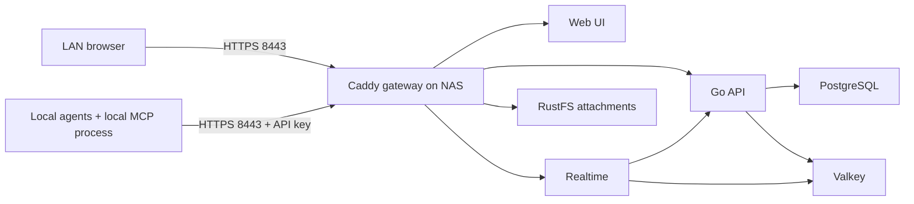

# Deploy Paca privately on the Synology DS1821+

For the newer setup running on this Mac with OrbStack, blocked outbound connections and encrypted NAS backups, use [the OrbStack guide](deploy/orbstack/README.md). The instructions below deploy directly onto the NAS.

Start with [the research and security review](deploy/synology/REVIEW.md). Recommendation: **evaluation only for now; keep primary work in Trello**. The current image scans report high-severity findings across the stack, with some critical records. A LAN pilot with disposable data and workstation agents is feasible, but this bundle is not a security clearance for production migration. This setup deliberately leaves Paca's built-in agent execution and environments unavailable.

The fork is https://github.com/tschleuss/paca, branch `synology-lan`. Local checkout: `/Users/tschleuss/Documents/Repositories/paca`. It is based on upstream **v0.19.1**, not the moving `master` branch. Our additions live under `deploy/synology/` so upstream merges are easier. The NAS uses released images; editing application source in the fork does not change those images. Application code modifications require building and pinning your own images.

## 1. What runs where



Seven persistent containers plus one initialization job. Only the gateway publishes a TCP port. No Docker socket, privileged containers, host networking, agent sandboxes, LLM models or NAS file shares are mounted. All persistent app data stays beneath `deploy/synology/state/`. The API/database/storage network is Docker-internal; cloud integrations are intentionally unavailable from it.

Your DS1821+ has **the stock 4 GB RAM**, confirmed during this review. I do not recommend putting primary agent work on this stack alongside your existing NAS services at that capacity. A short disposable-data trial may fit; ongoing use needs more measured headroom or a separate local host.

The DS1821+ supports the images' AMD64 architecture. **8 GB+ installed RAM with 3–4 GB free is the suggested starting point; 16 GB provides more room alongside other services.** Stock 4 GB needs a careful trial. These are estimates, not a NAS benchmark. The configured container limits total 3.25 GiB; DSM and other services need memory too. Use Resource Monitor and `docker stats` during real work. See REVIEW.md for the local idle measurement and RustFS considerations.

## 2. NAS preparation and private network

1. Check DSM version and available memory. Install **Container Manager** from Package Center (the Project UI is available on supported DSM 7.2+ installations). Older Docker packages may need a DSM/package upgrade. Do not install a newer Compose binary over Synology's packages casually.
2. Give the NAS a DHCP reservation, e.g. `192.168.1.20`. Set a local DNS record `paca.home.arpa` to that address using your router/DNS server. Alternatively use the NAS IPv4 itself as `PACA_HOST`; the private certificate can cover an IP. Use the same address consistently in browser, MCP and `PUBLIC_URL`.
3. Confirm TCP 8443 is unused. No router port forwarding, UPnP mappings, public reverse proxy, QuickConnect publishing or public DNS endpoint is needed. Review existing DMZ/forwarding rules too: a private IP binding alone does not defeat router forwarding.
4. Restrict NAS access to trusted LAN/VLAN clients. The gateway also checks the actual socket source against `LAN_CIDR`. Guest Wi-Fi should fail to connect. Docker programs firewall/NAT rules: do not assume DSM's UI firewall alone blocks published containers. Verify access from an allowed client and a disallowed VLAN/device. Keep the application behind the router with no inbound WAN route.
5. Create `/volume1/docker/paca` on your normal Btrfs volume (change volume number if necessary). Keep NAS shared-folder access limited to administrators/backup accounts; `.env`, backups, database and Caddy private CA keys must not be shared with ordinary LAN users. Let containers manage their data ownership. Do not recursively chmod state to 777 or apply DSM ACL resets across it.

The example assumes `192.168.1.0/24`; replace it with your actual trusted subnet. Do not set `0.0.0.0/0`. If an unexpected 403 appears, inspect the real client source, including VPN/proxy address translation. Do not solve it by allowing every address. This guide connects clients directly to Caddy; putting DSM Reverse Proxy in front changes the source-IP trust model and needs a separate configuration review.

## 3. Copy the deployment and initialize it

You only need the `deploy/synology` directory on the NAS, not the entire source tree. **Do not copy this Mac's test `.env` or `state/` directory to the NAS.** They contain disposable local test configuration/data.

On the Mac:

```sh
cd /Users/tschleuss/Documents/Repositories/paca
rsync -av --exclude='.env' --exclude='state/' --exclude='backups/' \
  --exclude='.backup-lock/' --exclude='__pycache__/' --exclude='private/' --exclude='node_modules/' \
  deploy/synology/ YOUR_NAS_ADMIN@192.168.1.20:/volume1/docker/paca/
```

If rsync over SSH is unavailable, copy the same source files using File Station. SSH can be enabled temporarily under DSM Terminal & SNMP. Docker commands normally require a NAS administrator running `sudo -i`; use SSH only from your trusted LAN.

On the NAS:

```sh
sudo -i
cd /volume1/docker/paca
sh scripts/init.sh
vi .env
```

Set these five values to match your network; keep the generated secrets:

```dotenv
NAS_BIND_IP=192.168.1.20
PACA_HOST=paca.home.arpa
PACA_PORT=8443
LAN_CIDR=192.168.1.0/24
PUBLIC_URL=https://paca.home.arpa:8443
```

`PACA_HOST` has no scheme, path or port. `PUBLIC_URL` is the complete HTTPS origin without a trailing slash. Use a private NAS IPv4 binding, never a wildcard. The secret generator uses hex so the database URL is safe without URL-encoding. Do not replace the database password with arbitrary punctuation without also encoding the connection URL. `init.sh` refuses to overwrite existing `.env`.

Validate and pull before creating containers:

```sh
docker compose version
docker compose --env-file .env -f compose.yaml config -q
docker compose --env-file .env -f compose.yaml pull
docker compose --env-file .env -f compose.yaml up -d
docker compose --env-file .env -f compose.yaml ps
```

Docker Compose v2 is required. This file avoids newer `depends_on.required` syntax used upstream. Container Manager can instead create a Project from `/volume1/docker/paca/compose.yaml`; keep `.env` alongside it. The SSH commands make failures clearer. Do not combine this file with upstream Compose or run the upstream installer over this directory.

First startup performs DB migrations, initializes object storage and creates the admin account. Allow a few minutes. `rustfs-init` should exit successfully; it is not a permanently running service. `api`, `postgres`, `valkey`, `rustfs`, and `realtime` should be healthy; web and gateway should be running. If a dependency fails, inspect it before retrying:

```sh
docker compose --env-file .env -f compose.yaml logs --tail=100 api rustfs postgres gateway
docker stats --no-stream
```

`expose`/image PORTS like 5432/tcp are not published host ports. `docker compose ps` should show **only NAS_IP:8443->443/tcp** as a host mapping. No 80, 443, 5432, 6379, 9000 or 9001 host mapping should appear.

## 4. Trust local HTTPS and sign in

Caddy uses its own certificate authority. It does not contact Let's Encrypt or need WAN ingress. After the gateway starts, its public root certificate is:

```
/volume1/docker/paca/state/caddy/data/caddy/pki/authorities/local/root.crt
```

Copy **only `root.crt`** securely to your Mac, e.g. `~/.config/paca/root.crt`. Inspect its SHA-256 fingerprint on the NAS and compare it with the copy:

```sh
openssl x509 -in state/caddy/data/caddy/pki/authorities/local/root.crt -noout -fingerprint -sha256
```

For the browser, import the public root into macOS Keychain Access and trust it for SSL. A trusted CA can issue certificates your computer accepts: keep the corresponding private keys on the NAS and restrict their backups. Do not distribute `root.key` or `intermediate.key`. Other operating systems/browsers need their own trust-store setup. Firefox may use its own certificate store.

Use the public root explicitly for command-line clients:

```sh
curl --cacert ~/.config/paca/root.crt https://paca.home.arpa:8443/api/healthz
```

Expect `{"status":"ok"}`. Do not disable certificate validation as the ongoing solution. Open `https://paca.home.arpa:8443`, sign in as `pacaadmin` with the generated `ADMIN_PASSWORD` from `.env`, and complete the required first-login password change. Save the new password in your password manager. Changing `.env` later does not reset an existing user's database password.

Create a project and a test task. Verify two browser sessions see task changes, upload/download a small file, restart the stack and confirm the data survives. Run a backup/restore drill before importing important work.

## 5. Connect agents from your computers

Paca's MCP server is a **local stdio process** that calls the NAS REST API. There is no remote `/mcp` endpoint to put into an HTTP MCP field. Do not append `/api` to `PACA_API_URL`; the MCP code supplies API paths.

Create a separate **service account and API key per agent or trust boundary** in Paca Administration → Service Accounts. Invite that service account into only the needed project and attach a project role. Keep workspace/global roles empty unless necessary. API keys inherit their account's roles; naming a key does not scope it. Do not give agents your admin personal API key.

Example custom project role policy (replace the UUID in both resources):

```json
{
  "version": "2026-10-01",
  "statements": [{
    "effect": "Allow",
    "actions": ["projects:read", "project.members:read", "tasks:read", "tasks:write", "sprints:read", "views:read", "docs:read"],
    "resources": ["project/PROJECT_UUID", "project/PROJECT_UUID/*"]
  }]
}
```

Add `docs:write` or `sprints:write` only for agents that need them. Keep role/identity/plugin/environment administration out of worker accounts. Test that a worker can create/edit its project task and gets 403 for a task in a second project. `PACA_PROJECT_ID` helps keep MCP calls focused but is not an authorization boundary.

Install Node.js 24 LTS or newer supported Node on **each agent host**. The upstream documentation's older Node 18 suggestion is insufficiently conservative for the current dependency tree. Install the pinned MCP package once into an isolated directory:

```sh
mkdir -p ~/.local/share/paca-mcp ~/.local/bin ~/.config/paca
cp /Users/tschleuss/Documents/Repositories/paca/deploy/synology/agents/package.json ~/.local/share/paca-mcp/
cp /Users/tschleuss/Documents/Repositories/paca/deploy/synology/agents/package-lock.json ~/.local/share/paca-mcp/
npm ci --prefix ~/.local/share/paca-mcp --ignore-scripts
cp /Users/tschleuss/Documents/Repositories/paca/deploy/synology/agents/start-paca.sh ~/.local/bin/start-paca
cp /Users/tschleuss/Documents/Repositories/paca/deploy/synology/agents/agent.env.example ~/.config/paca/agent.env
chmod 700 ~/.local/bin/start-paca
chmod 600 ~/.config/paca/agent.env
command -v node
```

The supplied client manifest pins Paca 0.19.1 and overrides vulnerable dependencies to MCP SDK 1.32.1 and uuid 11.1.1. The original npm package currently pins SDK 1.31.0. The locked override set passed local MCP read/write and Markdown conversion checks, and `npm audit --omit=dev` reported zero known findings on the review date. Overrides are our maintained customization: recheck compatibility and advisories at every update.

Edit `~/.config/paca/agent.env`: set the account key, HTTPS origin, absolute Node executable and public CA certificate path. The wrapper explicitly loads this file, which makes GUI-launched agents independent of your interactive shell environment. Keep the generated `package-lock.json`; `npm ci --prefix ~/.local/share/paca-mcp --ignore-scripts` recreates that dependency set later. If your npm policy quarantines very recent releases, wait for the release to age rather than disabling that global policy. Do not use an unversioned `npx ...` at each agent startup.

For different identities on one Mac, use distinct copies of the credential file and supply `PACA_LOCAL_CONFIG` to each MCP entry. Never commit them into repository configuration.

**Codex CLI / desktop / IDE using Codex configuration:**

```sh
codex mcp add paca -- /Users/tschleuss/.local/bin/start-paca
```

Equivalent entry in `~/.codex/config.toml`:

```toml
[mcp_servers.paca]
command = "/Users/tschleuss/.local/bin/start-paca"
startup_timeout_sec = 60
# Avoid the known v0.19.1 task-move defect; use update_task instead.
disabled_tools = ["move_task", "bulk_move_tasks"]
```

Use either method, without duplicating the table. Restart the agent session and inspect `/mcp`. See [official OpenAI MCP documentation](https://developers.openai.com/codex/mcp). The command syntax was also checked against the installed CLI.

**Claude Desktop / Claude Code / Cursor / other JSON-based MCP clients:** add a local stdio server to the client's MCP configuration:

```json
{
  "mcpServers": {
    "paca": {
      "command": "/Users/tschleuss/.local/bin/start-paca",
      "args": []
    }
  }
}
```

Merge with existing configuration, do not replace other servers. Claude Desktop on macOS uses `~/Library/Application Support/Claude/claude_desktop_config.json`; Claude Code can use a project `.mcp.json`; Cursor uses its MCP settings / `.cursor/mcp.json`. Check the installed client's settings if its format differs. The absolute paths are per computer. For one client with a separate identity, add an `env` map with `PACA_LOCAL_CONFIG` pointing to its private credential file.

**Superset:** configure MCP in the actual underlying local agent client used by each workspace. A Superset CLI process being local does not mean its credential-proxy MCP calls are local: connected plugin calls can be routed through Superset's API. A cloud-hosted proxy cannot directly reach `192.168.x.x` or your private DNS. Use local stdio MCP for LAN agents. A remote/cloud worker would require private routed network access plus trusted TLS and a permitted source subnet; that is outside this LAN-only deployment. Do not expose the NAS publicly to make cloud connectors work.

Ask each agent to list projects, create a disposable task, read it back, change its status with `update_task`, read it back again, and add a comment. Check attribution is its service account. Follow all pagination cursors when inventorying work. Avoid `move_task` and `bulk_move_tasks` until [upstream #610](https://github.com/Paca-AI/paca/issues/610) is fixed in a tested release.

Paca MCP does not automatically dispatch work to idle agents. Keep your existing Superset sessions/schedulers; point their task lookup/update tools at Paca. Paca-driven in-app chat, ACP bridges, static environments, automatic agent dispatch, preview terminals and SSH require the omitted runner and are unavailable here. Consider a separate dedicated execution host later if you need those capabilities.

## 6. Migrate Trello safely

**OrbStack/Stash update (2026-10-22):** the Stash export has now been imported into the local OrbStack instance with native comments and interactive checklists. See [the current Stash migration guide](deploy/synology/migration/HOW_TO.md) for verified counts, the board without a sprint, private recovery records and the richer importer. Agent configuration has not been switched. The older NAS/text-only procedure below remains a separate reference.

**Do not cut over primary work until the image findings in REVIEW.md are resolved or individually assessed with adequate evidence.** The NAS migration steps below were originally prepared for trial data and a later cutover; the OrbStack/Stash import is documented separately above. Workspaces are not a one-to-one data model match: Paca currently presents a workspace/instance with projects, while Trello has multiple workspaces containing boards. Start with **one Paca project per Trello board**, named with a workspace prefix. This does not preserve Trello workspace privacy as a separate security boundary: configure project roles explicitly. Use separate Paca instances if separate administrative isolation is required.

| Trello item | Destination / treatment |
|---|---|
| Workspace | Project naming prefix and project roles; no automatic tenant migration |
| Board | One manually created Paca project |
| List | A configured task status; use list ID → status UUID mapping |
| Card | Task; source URL and source ID retained |
| Description | Text in BlockNote paragraphs; Markdown markers stay literal |
| Labels | Task tags |
| Start / due | Task dates, preserved as original ISO timestamps |
| Members | Names/IDs recorded in description; assign mapped Paca members manually |
| Checklists | Checkbox text in description; not interactive checklists |
| Comments | Available export comments with original author/date recorded in description; not original Paca audit events |
| Custom fields | Raw exported values in description; original export retains definitions |
| Attachments | URLs recorded; bytes must be downloaded/exported separately and uploaded to Paca |
| Archived cards / lists | Skipped by default; `--include-archived` imports as ordinary tasks with source archive flag in text |
| Butler rules, Power-Ups, permissions, subscriptions, full audit history | Rebuild or archive separately; not automatically migrated |

1. Export every board as JSON using Trello's board menu → Print/export/share → JSON. Keep a dated read-only export and original attachment files. JSON alone is not an attachment backup. Workspace export options depend on your Trello plan. See [Atlassian's export guidance](https://support.atlassian.com/trello/docs/trello-premium-user-guide/) and [JSON format explanation](https://support.atlassian.com/trello/docs/making-sense-of-trellos-json-export/). Board exports may omit older actions; absence of a comment in the export means the script cannot migrate it.
2. Put exports in `deploy/synology/migration/private/` on your Mac, outside tracked Git data. Include Inbox work explicitly in your inventory; it is not necessarily present in board exports. Keep a separate archive of any data not in those exports.
3. Create a trial project and statuses in Paca. Review the JSON's `lists` IDs and obtain each destination status UUID using MCP/API. Copy `migration/mapping.example.json` to the ignored `private/` directory and fill all included lists' mappings. The importer requires complete mappings before writing anything.
4. Build an **offline plan**, requiring Python 3 only:

```sh
cd /Users/tschleuss/Documents/Repositories/paca/deploy/synology
python3 migration/trello_import.py migration/private/board.json \
  --output migration/private/plan.json
```

Inspect titles, list mapping, dates, checklists, comments, tags and skipped archived count. Keep original files; the plan is a convenience conversion, not a lossless Trello backup.

5. Set a temporary importer service account with access only to that destination project. For the terminal running the import, export `PACA_API_URL` and `PACA_API_KEY` from a private file/password manager. Do not put keys in command arguments or shell history. Apply to the **trial project**:

```sh
python3 migration/trello_import.py migration/private/board.json \
  --output migration/private/plan.json \
  --mapping migration/private/mapping.json \
  --journal migration/private/id-map.json \
  --ca ~/.config/paca/root.crt --apply
```

The importer creates tasks only. It scans every destination task page for the `trello-id-CARDID` tag, keeps an atomic source→destination journal and reads each task back to verify ID marker/title/status. It refuses to silently recreate a journaled task it can no longer see. Keep tags and journals intact. Do not run concurrent importers, reuse a destination project for different source boards, or edit source cards while importing. Re-running does **not** synchronize edits or refresh existing descriptions/dates/comments. Network failures stop the run; inspect destination before retrying. A very large card may exceed API/gateway limits: split it deliberately and retain the original rather than truncating it silently.

6. Download/verify attachments while Trello is available, then upload their bytes through Paca. Reassign owners, reconstruct custom fields if needed, recreate only necessary automations. Check every list's card count, all urgent due dates, a sample of comments/checklists, private project access and every important attachment. Read back imported descriptions, not just titles. Keep counts separate for archived/skipped items.
7. For cutover, freeze the chosen Trello boards and stop agents writing to them, take final exports, import final data into clean destination projects using fresh maps, and reconcile again. Change agent instructions/configuration to use the new project IDs. Keep the old Trello boards read-only for at least 30 days; do not delete them to “complete” migration. If the pilot fails, switch agents back and reconcile work added to Paca during the pilot.

Superset workspaces, git worktrees, repository files, running terminals, agent transcripts and schedules stay where they are. They are not Trello cards and are not migrated into Paca. Add a small `WORK_TRACKING.md` per repository with its Paca project UUID, status meanings, ownership/claim conventions, and instructions to verify writes. Update existing agent prompts and schedules that reference Trello tools or card URLs. Keep a source-card→task mapping to resolve old links. Paca is the new task system, not a replacement for Superset workspace management.

## 7. Backups, retention and restore

`state/` contains the database, attachment store, Valkey queues, plugin files and Caddy CA/certificates. `.env` contains the encryption key and other secrets. Losing `ENCRYPTION_KEY` can make stored integration secrets unreadable. Database-only backups do not include attachments; live filesystem copies of a running Postgres directory are not sufficient backups.

The supplied **cold backup** briefly stops the gateway and all writers, creates a logical PostgreSQL dump, stops PostgreSQL, then archives all stopped persistent state plus configuration and scripts. It verifies dump readability and archive structure, writes a SHA-256 checksum, and attempts to restart services even after failure. A lock prevents two copies of the script from running at once. Do not update or run Container Manager actions during backup. A killed process/host outage can leave `.backup-lock`; check for an active backup before removing that stale lock.

Run manually first:

```sh
cd /volume1/docker/paca
sh scripts/backup.sh
```

Schedule as root with DSM Task Scheduler → Scheduled Task → User-defined script, e.g. daily at **02:30 America/Winnipeg**, command:

```sh
cd /volume1/docker/paca && /bin/sh scripts/backup.sh
```

Enable failure notifications. Check that the archive/checksum actually appears and that the app returns healthy. Copy completed archives to a separate destination using Hyper Backup with encryption; exclude working/partial files. Archive checksums check corruption, not authenticity. Backups include API secrets and the private CA: encrypt removable/offsite copies and keep recovery credentials outside the NAS.

Suggested policy: 7 daily + 4 weekly + 6 monthly recovery points, adjusted to storage budget. The script intentionally does not auto-delete old backups: configure verified destination retention and only remove local archives after confirming another recoverable copy exists. Btrfs snapshots are useful in addition to these backups. Keep at least one offline/offsite copy; RAID and another folder on the same NAS do not cover NAS loss. Back up workstations/repos and migration exports separately. Daily backups imply up to 24 hours of lost task changes; run more often if that is unacceptable, accepting more downtime.

**Restore drill / exact-version disaster recovery:** use a separate empty NAS folder/project or a separate test Docker host. Never unpack over running production state.

```sh
mkdir -p /volume1/docker/paca-restore
cd /volume1/docker/paca-restore
# Copy a chosen completed backup archive here from secure storage.
# Compare its SHA-256 to the original .sha256 file first.
tar -xf paca-YYYYMMDDTHHMMSSZ.tar
tar -xzf state.tar.gz
```

This restores `.env`, Compose, image lock, Caddy config, scripts and cold state. Preserve ownership (run NAS extraction as root). Protect the restored directory from other users. **If testing on a second CPU architecture, use the logical DB restore below**; a raw data-directory copy is intended for the same PostgreSQL platform/version, not arbitrary architecture or major-version moves.

Change `.env` to an unused private host/IP/port/origin for the restore instance. With an alternate hostname Caddy issues a new leaf certificate using the restored CA. If restoring on the same host, use a different project name and port:

```sh
docker compose -p paca-restore --env-file .env -f compose.yaml up -d
```

The backup script uses the original Compose project name. Do not run it from a concurrent restore instance unless you first change that instance's `name:` in `compose.yaml` to `paca-restore` too. Test login, task counts, sample descriptions and attachment downloads. Never let restored test agents act on real work. Record restore time and result. Stop the restore project when finished; retain the verified backup.

**Logical database recovery:** useful for a clean DB rebuild or planned Postgres platform migration. Start from the restored bundle in an isolated empty project, with the gateway/API stopped. Stop the restore project completely with `docker compose -p paca-restore --env-file .env -f compose.yaml down`. In the restored Compose file change only the PostgreSQL bind source from `./state/postgres` to a **new empty** `./state/postgres-fresh` directory and create that directory. Using a new path also avoids stale bind-mount identity caches on Mac test hosts. Start only PostgreSQL and wait for it to be healthy. Confirm `SELECT count(*) FROM pg_tables WHERE schemaname='public';` returns 0 before restoring; if it does not, stop and choose a genuinely empty database. Then:

```sh
docker compose -p paca-restore --env-file .env -f compose.yaml up -d postgres
docker compose -p paca-restore --env-file .env -f compose.yaml exec -T postgres \
  pg_restore -U paca -d paca --no-owner --exit-on-error < database.dump
docker compose -p paca-restore --env-file .env -f compose.yaml up -d
```

Use a fresh empty `paca` database, matching database image major version first. Keep the corresponding RustFS/plugin/Caddy state and `.env` from the same backup. A Postgres restore alone does not restore files. For actual hardware failure, restore to the original hostname/IP after the old instance is offline, verify everything, then resume agents.

## 8. Upstream updates and rollback

Do not enable Watchtower or automatic image upgrades. All images are pinned by digest in `compose.yaml`, including databases and gateway; image tags alone are mutable. `images.lock.json` records the reviewed versions/manifests. Keep the DB major version at 16 until a separate, tested migration is planned.

On the Mac, keep our deployment branch while importing upstream release changes:

```sh
cd /Users/tschleuss/Documents/Repositories/paca
git switch synology-lan
git status --short
git fetch upstream --tags
# Replace vX.Y.Z with an explicitly reviewed release, not master/latest.
git log --oneline v0.19.1..vX.Y.Z
git diff v0.19.1 vX.Y.Z -- deploy/docker-compose.prod.yml deploy/caddy/Caddyfile services/api/migrations apps/mcp/package.json
git merge --no-ff vX.Y.Z
```

Read the release notes and all new security advisories. The upstream upgrade script may contain migrations/config transitions not captured by an image bump: inspect its changes too. Adapt our standalone Compose/Caddy configuration manually, adding any new mandatory settings and preserving LAN binding, TLS, no-runner design and private state. Do not run `upgrade.sh` directly over the customized deployment.

Resolve and inspect new immutable image digests, e.g.:

```sh
docker buildx imagetools inspect pacaai/paca-api:X.Y.Z
```

Verify `linux/amd64` support, review image/dependency scan results, then update all relevant app images together and update `images.lock.json`. Commit configuration with the tag, digests and review date. The release tag and npm package use different formatting (`vX.Y.Z` versus `X.Y.Z`). Updating source without updating the image pins leaves the NAS on the old release.

Create a backup, restore it into an isolated staging project, and test the new images there first. Schema migrations run on API startup. Test login, restricted-account permissions, MCP read/write and pagination, task/sprint changes, realtime and attachment round trips. Review whether our SDK/uuid overrides are still needed, rebuild/relock the workstation MCP installation to the matching npm version and test it too; the server and MCP package versions need to stay compatible.

For production, stop agents, create a new complete backup, save the old deployment bundle, copy reviewed source config files without overwriting `.env` or `state/`, pull and start the new stack, then check health and read back real tasks. Only resume agents after verification.

If anything fails, stop the new stack. Restore the **entire pre-update backup** into an empty directory using its old pinned Compose/config/secrets/data, with the failed instance offline. Do not point the old API at a database already migrated by the new version. Restoring loses changes made since the backup: pause agent writers through the upgrade window to keep that loss bounded. Reconcile any accepted writes before rolling back.

## 9. Operating checks and limitations

Check weekly: free RAM/disk, restart/OOM counts, unhealthy services, latest successful off-device backup and new security advisories. Run a restore drill monthly and after changing backup/storage configuration. Rotate/revoke individual agent keys when a machine or agent is retired. Keep DSM/Container Manager patched and schedule coordinated dependency/image refreshes.

If tasks are lost or overwritten, stop automated writers and inspect Paca activity plus agent logs before restoring. Task reads followed by writes are not a transactional work-claim lock: start with one dispatcher per project/queue, explicit ownership, and read-back verification. Two independent agents can race. Hosting locally removes Trello's cloud dependency; it does not guarantee correctness under concurrency or eliminate power/network failures. A UPS helps a NAS that hosts important live services.

Current scope is LAN task/project management with external local agents. It does not include in-NAS execution, a local LLM, seamless Trello tenant/history migration, bidirectional Trello sync, automatic idle-agent dispatch, or remote cloud access. These boundaries are part of keeping the NAS deployment manageable.

See [VALIDATION.md](deploy/synology/VALIDATION.md) for exactly what was exercised locally and what still needs checking on your hardware.
